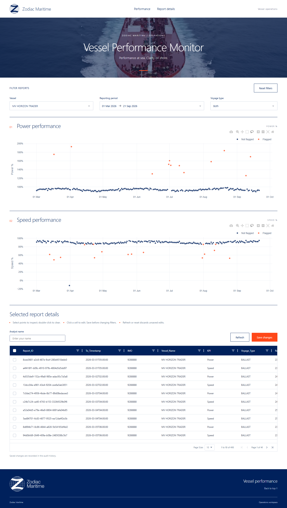

# Vessel Performance Monitor

Dash dashboard for Power/Speed analysis and audited report editing.

## Preview

<p align="center">
  <a href="docs/images/dashboard-preview.png">
    
  </a>
</p>

Click the preview to view the full-size screenshot.

## Run

Python 3.11/3.12, Windows PowerShell:

```powershell
python -m venv .venv312
.\.venv312\Scripts\Activate.ps1
python -m pip install -r requirements.txt
python app.py
```

Open http://localhost:8000. The existing `.venv312` is ready to use.

Linux/macOS: activate with `source .venv312/bin/activate`, then run the command from `app.yaml`:

```bash
gunicorn --config gunicorn_conf.py app:server
```

## Use

- Vessel/date/voyage filters apply together. Box/lasso selections combine; no selection shows all matching reports.
- Edit cells, enter your name, and click **Save changes**.
- **Refresh** discards edits; **Reset filters** restores defaults and clears selections/table filters. Save before changing filters or selections.

## Notes

- **Storage:** `vessels.sqlite3` holds reports and `audit_log` (report ID, field, old/new values, analyst, UTC timestamp). Saves are atomic; the CSV stays unchanged.
- **Validation:** See `validation.py` and the assumptions below. Validation applies to edited fields and affected relationships; existing source issues can remain while unrelated fields are corrected.
- **Databricks:** `app.yaml` defines Gunicorn/environment settings; `gunicorn_conf.py` uses the injected `DATABRICKS_APP_PORT`. This is a stub, with local SQLite demo storage. Next: authenticated users, durable storage, confirmed business rules.

**Tests:** `python -m pytest -q` uses temporary databases. Browser tests require Chrome and `RUN_BROWSER_TESTS=1`.

## Assumptions

- **KPI structure:** Each source row describes either Power or Speed. Blanks in fields belonging to the other KPI are expected and are preserved.
- **Validation limits:** KPI percentages and baseline percentage fields use a 0-250 range; deviations use a -250 to 250 range. These are demonstration limits that require confirmation with operations. Baseline start must be on or before baseline end, and engine running hours must not exceed report duration.
- **Deviation formulas:** Power deviation is `Power_% - PWR_BSL_SAM`; Speed deviation is `Speed_% - SPD_BSL_OOS`. When the percentage or relevant baseline changes, the app recalculates the deviation to one decimal place unless the analyst explicitly edits the deviation in the same save. These formulas require business confirmation.
- **Source inaccuracies:** Missing readings, negative source percentages and duplicate report IDs are retained for analyst review rather than automatically repaired. Internal row keys identify records independently of report IDs; edited report IDs must be unique.
- **Anomaly flags:** Existing flags are preserved because their business rules were not provided. Analysts can edit them manually; the app does not automatically recompute them after a correction.
- **Selection behaviour:** Selections across Power and Speed charts combine to show records selected in either chart. With no chart selection, the table shows all records matching the active vessel, date and voyage filters.
- **Storage and identity:** Local SQLite demonstrates transactional writeback and audit logging. The analyst name is entered manually and is not an authenticated identity; governed storage and access controls are second-phase work.

### Second Phase actions:

1. I would confirm the KPI baseline formulas and business validation limits with operations.
2. Connect the app to governed Databricks tables with transactional writeback and identity-aware audit logs.
3. Add permissions and an audit-history viewer.
4. Run the existing automated tests in a continuous integration (CI) pipeline.

These changes would move the demonstration toward a robust shared operational tool.
